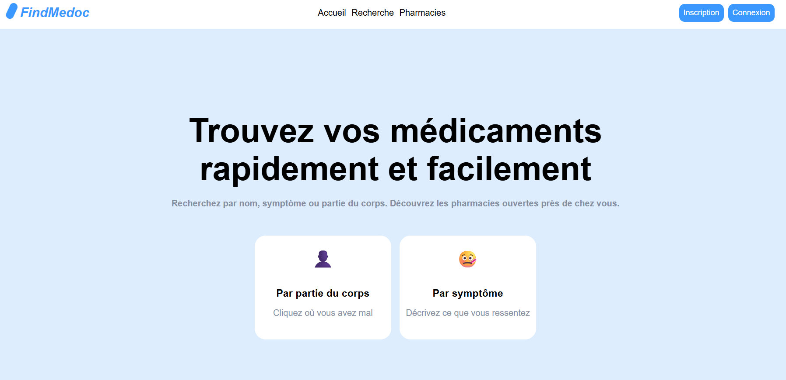
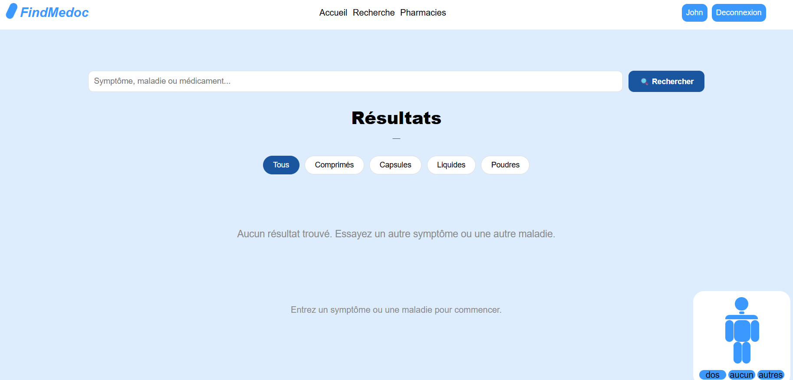
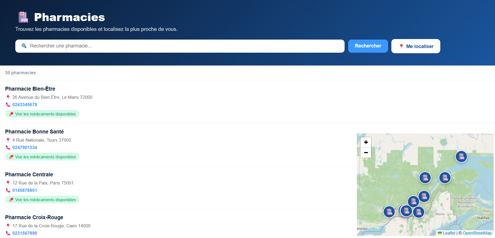
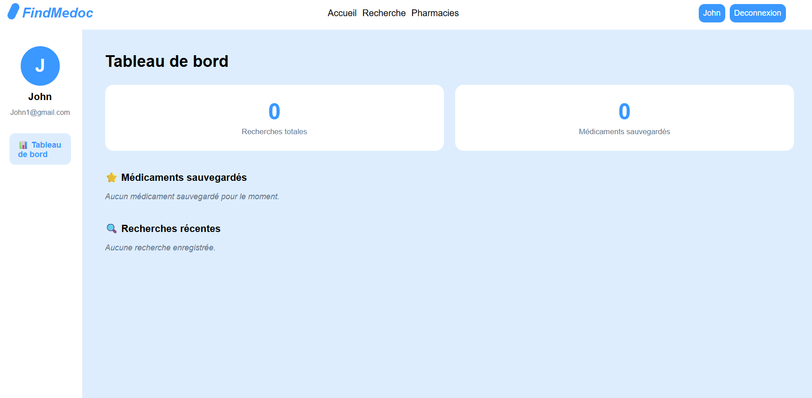
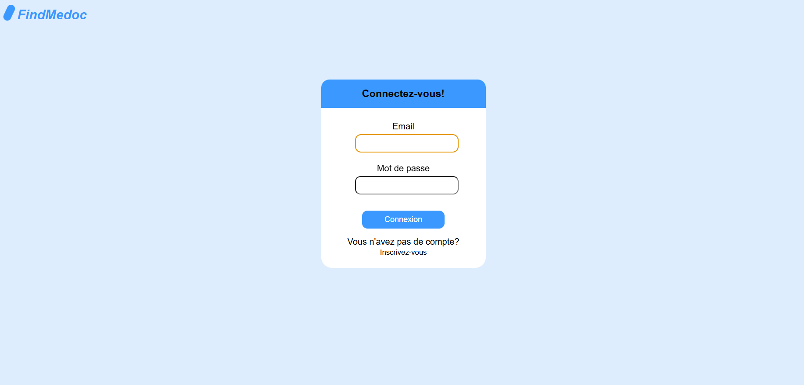
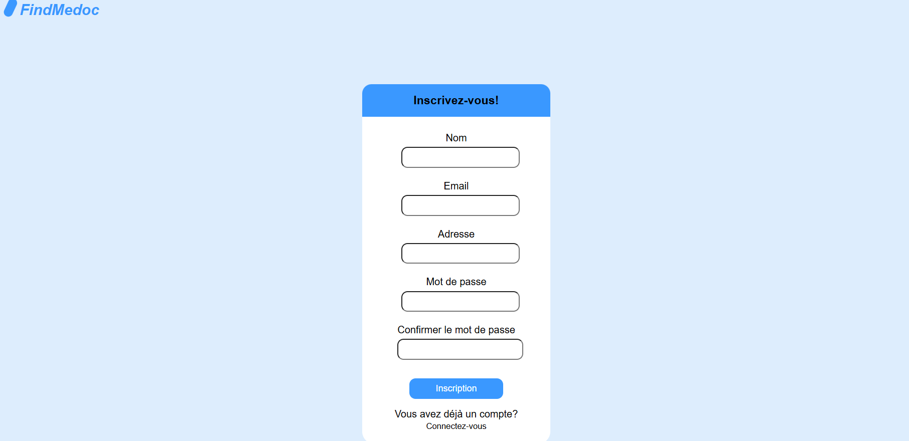
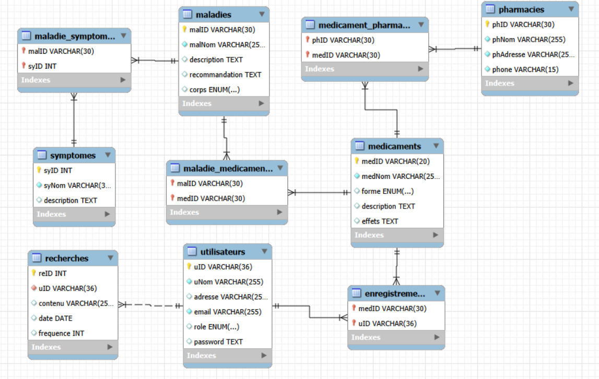

# FindMedoc 💊

Application web qui aide à trouver un médicament selon ses symptômes, une maladie ou une partie du corps, et à localiser les pharmacies les plus proches qui l'ont en stock.

> ⚠️ FindMedoc ne remplace pas un avis médical. En cas d'aggravation, consultez un médecin.

## Technologies

| Couche | Outils |
|---|---|
| Backend | Python, Flask, Jinja2, sessions Flask |
| Base de données | MySQL, PyMySQL, procédures stockées, index |
| Frontend | HTML, CSS, JavaScript (Fetch API) |
| Cartographie | Leaflet, OpenStreetMap, API Geolocation du navigateur |
| Sécurité | passlib (hachage SHA-256), UUID, python-dotenv |

## Fonctionnalités

- **Recherche de médicaments** par nom, maladie ou symptôme, avec filtres par forme (comprimé, liquide, poudre…) et par partie du corps.
- **Fiche détaillée** de chaque médicament (description, effets).
- **Pharmacies** : liste, recherche, carte interactive et tri par distance après géolocalisation (formule de Haversine).
- **Stock par pharmacie** : voir les médicaments disponibles dans chaque pharmacie.
- **Compte utilisateur** : inscription, connexion, favoris et historique de recherche avec statistiques.

## Aperçu

### Accueil

### Recherche de médicaments

### Pharmacies et carte

### Profil (favoris et historique)

### Connexion / Inscription
| Connexion | Inscription |
|---|---|
|  |  |

## Modèle de données

9 tables MySQL : `utilisateurs`, `medicaments`, `maladies`, `symptomes`, `pharmacies`, `recherches`, `enregistrements` (favoris) et les tables d'association `maladie_medicaments`, `maladie_symptomes`, `medicament_pharmacie`.

## Mes tâches

- Écriture des procédures stockées (statistiques utilisateur, favoris, historique, fréquence des recherches).
- Développement des routes Flask (authentification, favoris, historiques).
- Recherche multicritère en SQL (jointures maladies ↔ symptômes ↔ médicaments) avec requêtes paramétrées.
- Validation des formulaires côté client (regex pour nom, courriel et mot de passe robuste).

## Ce que j'ai appris

- Modéliser une base relationnelle avec des relations plusieurs-à-plusieurs et déplacer de la logique dans des **procédures stockées**.
- Protéger une application contre l'**injection SQL** grâce aux requêtes paramétrées.
- **Hacher les mots de passe** plutôt que les stocker en clair, et gérer l'état de connexion avec des sessions.
- Séparer les **secrets de configuration** du code avec un fichier `.env`.
- Intégrer une **carte interactive** et calculer des distances géographiques réelles.
- Construire une interface dynamique en JavaScript natif qui consomme une API JSON.

## Code source

Le code source est hébergé dans un dépôt privé (projet universitaire, Université Laval).
